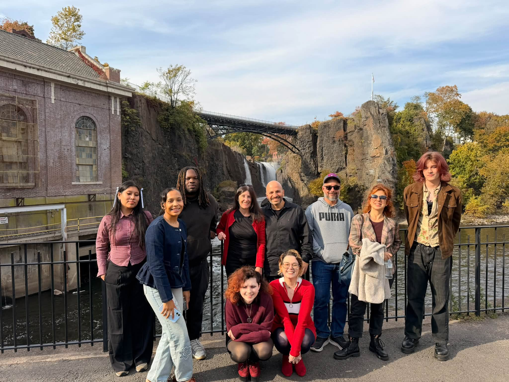
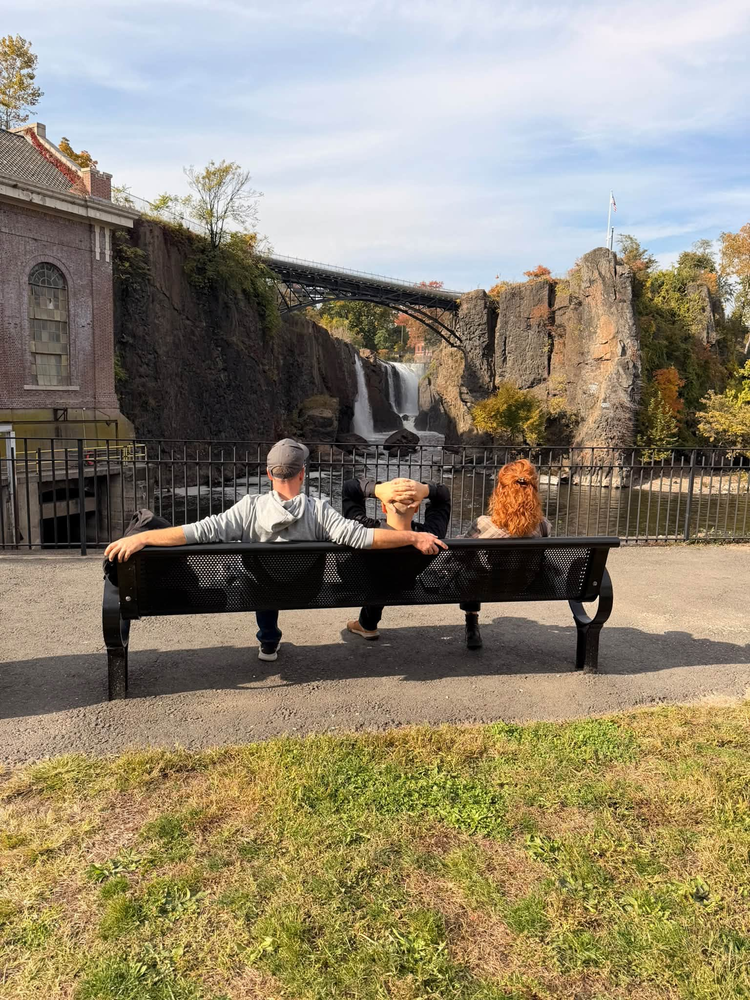

*StarWound performs alongside PCCC student poets at the "Interiors" showcase in the Hamilton Club on Oct. 28.*

The second floor of the Passaic County Community College Hamilton Club on Church Street in Paterson was full of music and poetry on Wednesday, Oct. 28, for a special one-day event.

Finding the inspiration for their piece was the first step for Lux Wright, who began after Poetry Center Director Dr. Christine Redman-Waldeyer asked the students to imagine themselves parallel to a natural element during a discussion on the theme of "Interiors." That prompt inspired Wright to write the line, "I am the water in the bowl, taking shape around a mold that is not my own." After spending approximately a month preparing, workshopping their poems and holding practice rehearsals with Redman-Waldeyer, Wright performed the completed work, "One Day," aloud at the Oct. 28 showcase with live music accompaniment.

PCCC students were among nine poets who took part in the "Interiors" project, a public performance where they paired poems with the musical compositions of StarWound, a sophisti-pop group from Greece.

Redman-Waldeyer, an English professor and director of the college Poetry Center, was also a participant among these young artists. Redman-Waldeyer was already familiar with StarWound, as the band had contacted her after discovering her poem “I am the Petals” online and previously turned it into a song.

This collaboration between students and StarWound was the result of an eight-stop U.S. tour centered around this project, for which PCCC was selected to participate alongside Johns Hopkins University, the University of Baltimore, Carnegie Mellon University, Dickinson College, Lehigh University, Stockton University and the Catholic University of America.

## Turning Verse into Song at the Hamilton Club

Three of the student poets spoke to Visions via email.

Litzi Gomez wrote a poem titled "My Own Path" about growing up in a family who hoped they would go into a medical career. However, writing was always their passion.

"My family never really saw writing as a career for me, but I always felt writing was a big part of me," Gomez said.

Gomez hoped the audience would take away a message about pursuing your own dreams. "At the end of the day, it is your life, so you should be able to do something that makes you happy," Gomez said.

Laura Rosa Urtarte wrote a poem exploring what makes you an individual.

"Sometimes we can feel like we have elements of our parents within us, their experiences, strengths, struggles and fears," Urtarte said. "However, I believe we can be more than just a reflection of our parents."

Urtarte hoped the audience understood that you can appreciate where you come from while still being your own person.

Wright wrote a poem titled "One Day," building on that water metaphor. Wright said the poem showed how easily they could fit into the energy of others, making them wonder if they really knew themselves.

"I wanted my poem to be truthful, but I didn’t want it to be too sad or melodramatic," Wright said. "I am hoping that I can find my own confidence and voice as I go through my college career."

StarWound felt the Hamilton Club group stood out as the largest group of student poets on the tour. After working with over a hundred students over the years, the band said, “We feel privileged as we get the chance to dive deeply into young people’s minds and souls.”

The PCCC poets wrote of self-consciousness, mental health and identity, which the band described as “a celebration of diversity and unity at the same time.”

StarWound said they were honored by the students' ability and willingness to trust them and were impressed by “the level of preparation and commitment this class had.” The band also praised Redman-Waldeyer as “an inspiring figure and a skilled team leader.”

## Collaboration with StarWound

The poets found working with the band to be a pleasant experience, noting that the members were very friendly. They even went outside to get fresh air and take photos by the river.

*Taking a breather at the Paterson Great Falls with Greek sophisti-pop band StarWound! So grateful for the chance to turn our poetry into live music for the “Interiors” showcase at PCCC. Top (L to R): Litzi Gomez, Laura Rosa Urtarte, Taj'mere Hunter, Dr. Christine Redman-Waldeyer, Petros Bouras (Piano & composer), Dimitris Azorakos (Drums), Konstantina Stavropoulou (Vocals & synthesizers), and Nicholas Grossi. Bottom (L to R): Autumn Williams and Lux Wright.*

"I loved how energetic they were and how welcoming they were," Gomez said.

The music in Gomez's poem created a mysterious feel. "It almost felt like it was from a film," Gomez said. "The words felt very dramatic."

StarWound’s process always began with the poems. The band read each poem to connect with the theme while growing their understanding of the mood and atmosphere. They then rehearsed it in the studio with lead singer Konstantina Stavropoulou reciting it, which helped them capture a sense of rhythm and choose a groove and melody from their prior discography.

The band emphasized that their choices represented only one possible interpretation, and that each poet might hear the poem differently, which they noted was “the whole point of this artistic dialogue.”

During day-of rehearsals, some students were caught by surprise when hearing the music, others let themselves get carried away by it, and others tried working through alternative arrangements.

“There is no right or wrong,” the band said, adding that the key was staying motivated and having the courage to decide on something new.

Although Wright was initially a bit nervous about keeping to a rhythm, the band reassured them they were the focus, and the music would follow their voices.

The band also worked with each poet individually. Wright's poem matched an upbeat instrumental to the positive theme. "They were super friendly and encouraging," Wright said. "I would definitely work with them again!"

Urtarte said the music added a whole new layer to her poem. "Poetry is a form of expressing emotion, but adding music to it has added a whole new layer to the message," Urtarte said.

During rehearsal, Gomez loved spending time with the other poets. "It was great to be surrounded by people who share the same passion for writing and creativity," Gomez said.

StarWound had performed at festivals such as Eurosonic, Culturescapes and Nisville. They had toured across Europe and the U.S. and had even worked with the Greek National Opera.

## Building Confidence

For several of the poets, this event was an opportunity to build confidence.

Gomez said they were very shy, and speaking in front of an audience was one of her biggest fears. "This project really helped me to come out of my shell and practice projecting my voice," Gomez said.

Wright still got nervous about speaking in front of people, but said it was progress. "It was very stressful, but very rewarding and fun as long as you let it be," Wright said.

The poets also gained a new perspective on poetry. Gomez said many people saw poetry as funny or embarrassing, however, they realized that “poetry isn’t as corny as some people make it seem.”

“Sometimes sharing a question can be just as powerful as having an answer,” Urtarte said.

Wright may only be at the start of their journey, but will continue to write poetry even if just for themselves.

*Looking out at the Paterson Great Falls from a bench along the river.*
