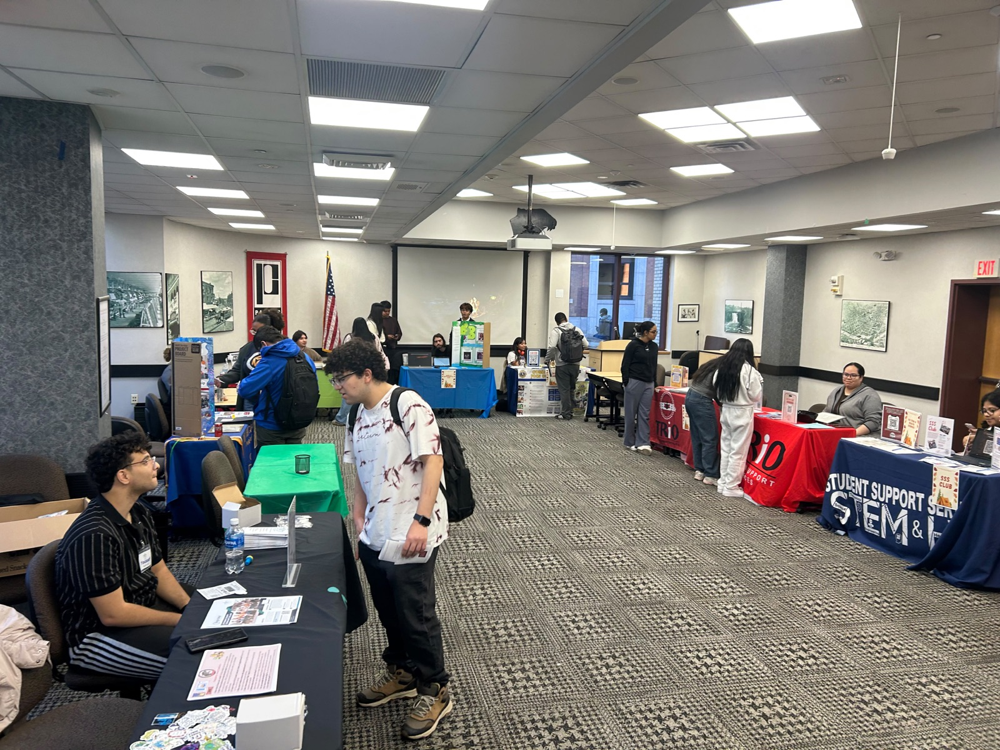
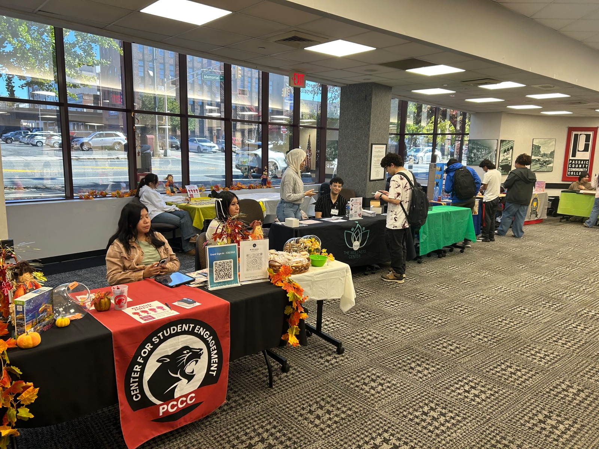
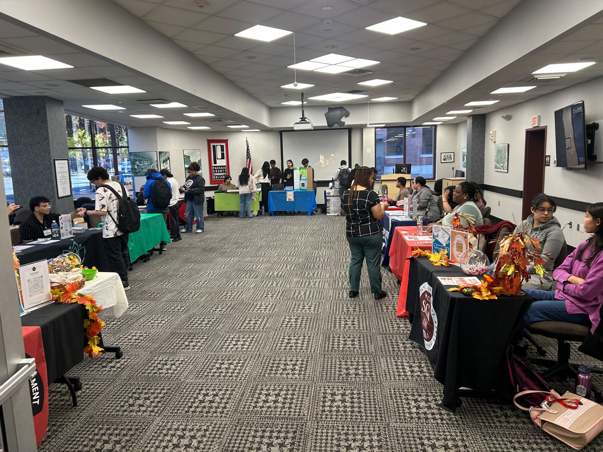

The week of October 19th, the Center of Student Engagement and the Student Government Association sponsored a campus-wide Involvement Fair event. Clubs and organizations from PCCC visited all three campuses to inform students of existing resources and activities they can participate in.

On the Paterson Campus’ Fall Involvement Fair, students were greeted with a fall-coated entryway, with autumn-colored leaves, jazz music, and warm smiles that made every student feel welcomed. Each table had its club or organization’s flyer, interest form, and little goodies each student could take to learn more about tables.

(Clubs and organizations set up tables at the Fall Involvement Fair on the Paterson Campus.)

There was a total of 13 tables present for event, clubs include Lions Club, Bridge to Baccalaureate, Environmental Club, and SSS Club (Student Support Services). Other organizations that were present include SSS-Trio (STEM, Classic, and ESL), Student Affairs, Center of Student Engagement, the Wellness Center, Career Champions/Career Services, Environmental Sustainability Program, Alpha Eta Chi (Phi Theta Kappa), and the Student Government Association.

When students signed in, they were given a stamp sheet that encouraged them to visit eight tables. Once they finished their interaction, the student would give the stamp sheet to the representative to stamp. Once students completed their sheet, they were to come back to the CSE table to claim one prize which included marshmallow pens and squishes, keychains, and candy.

(The Center for Student Engagement table, where students claimed their prizes.)

Light refreshments were served that included bags of Cheeze-Its and water. There was also a little crafts tables that allowed students to paint their own tree log keychain. The event was an overall success with a total of 75 students attending the Involvement Fair throughout all three campuses.

(Students visit tables around the hall.)
