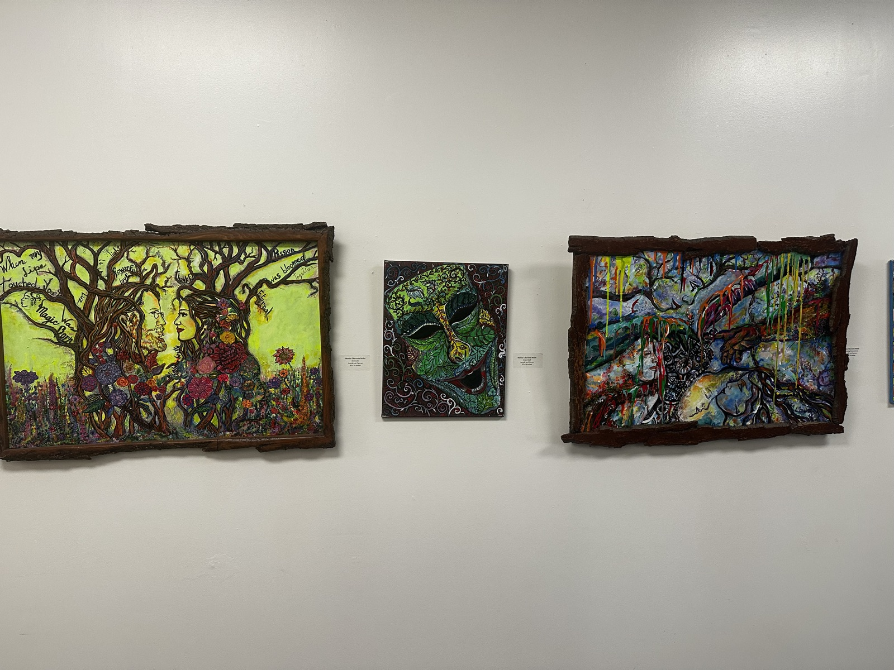
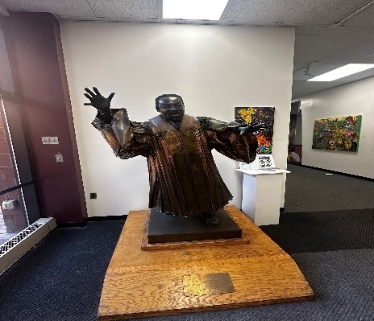
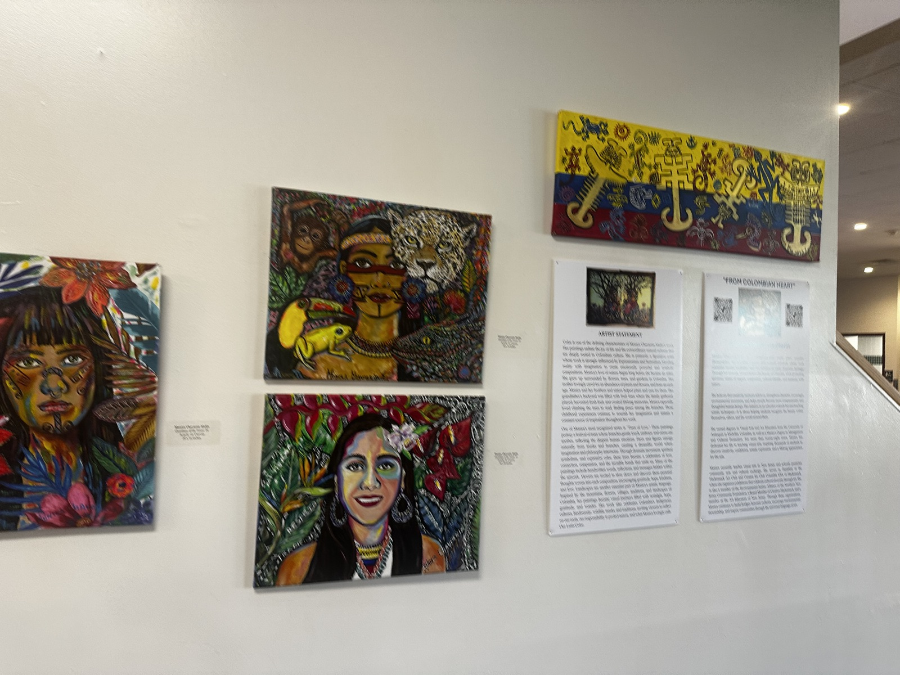
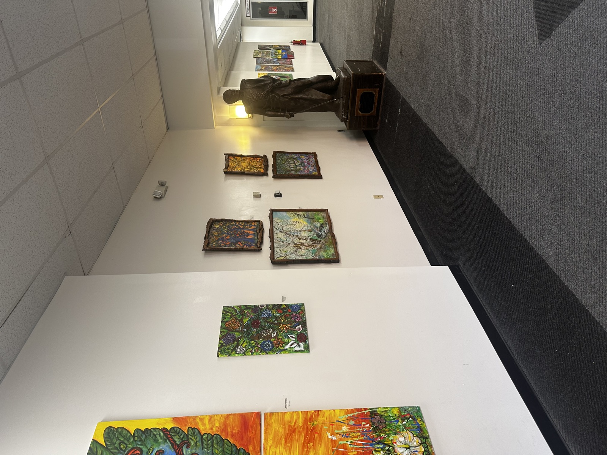

(The beauty at the corner of the cafeteria at PCCC.)

# Cafeteria Symphony

## The Rush

Step inside the packed cafeteria during the midday rush, and there will be a familiarity of smells, sounds and your senses are instantly hit with a wave of everyday chaos. There is a harmonious choir of scraping chairs, apple pay dings sounding throughout the room, the front door banging shut, the hums of refrigerators slamming, and the overlapping chatter of students with friends, the clicks of laptop keyboards and coffee cups hitting the surface of the tables. It is the high-energy, fast paced heart of the main campus.

The stairs are in the middle, security right of the cafeteria at their podium, the library bustling with students studying for exams or doing assignments. But before being able to cross to that side, a few feet away there is an opening, and a journey down that path, the volume drops. The air changes, the smells are different, even the lighting is brighter. There, hanging in the open corridor, is a vibrant collection of paintings, a mini student art gallery hidden in plain sight. A hallway at the very entrance of the school, next to the most popular room on the entire campus, tucked away as a little secret only for those who dare to venture down that way.

For most, this hallway is a transit zone, there is no knowledge of its existence, or nothing is there that requires many of us to take an adventure down that way. Most hurry through it with their eyes glued to their phones, laughing at whatever friends are saying, racing to class, or the music in our headphones is so loud and sweeping us away, we do not even see the environment around us. Yet the walls are quietly offering something entirely different; zero-cost mental decompression.

(Paintings in the hallway gallery.)

## The Mental Decompression

The contrast from this to the front entrance is striking. Just a few feet behind, the campus is in constant, frantic motion. And with a single turn, these canvases sit in perfect, beautiful stillness. The paintings, assuming are created by our own peers in the fine arts program, bring a sudden burst of human expression to an otherwise standard concrete walkway. Bold brushstrokes, vibrant, intense splashes of colors almost forcefully grabbing our attention.

Martin Luther King, one of the most prominent leaders’ statue is placed so gracefully, overseeing the walls PCCC art has to offer. The minute eyes are placed on these paintings it will be almost impossible to look away. The minor details will seem fascinating, the bright yellow colors screaming off the frames will call to us, and the bronze statues stagnant in their own corner will peak interests.

One does not need to be an art critic or an expert to appreciate it. In fact, the mystery is part of the appeal. These artworks speak for themselves. The Sistine Chappel of them all is a woman with wings, engulfed in yellow warmth, emulating sunlight. Her hair made of leaves, flowers blooming ever so gracefully at her feet, and in the nook of her wings in black and white letters read, “No War, Peace.” This is the biggest piece on the walls; she is hard to miss and gives a rather comforting feeling.

Another depicts a man and woman made from and entwined in branches. Colorful flowers bloomed around them, and black words were woven between their branches. ‘Power of love,’ ‘thankful,’ ‘passion was bloomed together,’ ‘when my lips touched yours, magic was born.’ Reading these words, staring at the people who were created from branches, one cannot help but smile. These artworks are silent reminders that beneath the surface of tests and schedules, Passaic County Community College is full of creative talent.

(The Martin Luther King statue stands in the hallway gallery.)

(More paintings and artist statements on the gallery wall.)

## Look Up from the Screens and Look at the Walls

The next time grabbing lunch or waiting for a friend by the cafeteria, challenge oneself to slow down. Leave the phones in pockets, purses, or backpacks for one minute and look at the walls in front. One could find that the best break in their day is not getting to finally stare at their phones, or sit solely in the cafeteria, but that quiet world hanging just outside its doors.

(The gallery hallway beside the cafeteria.)
