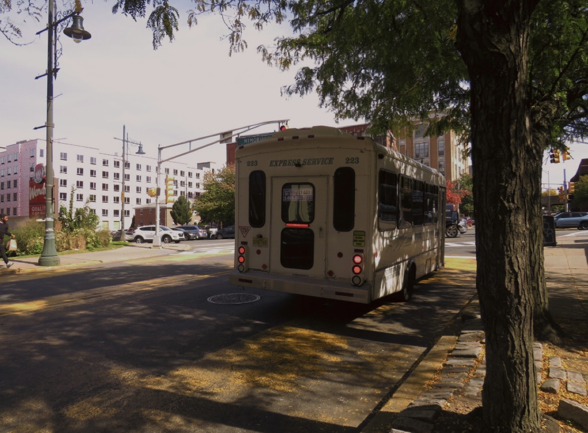
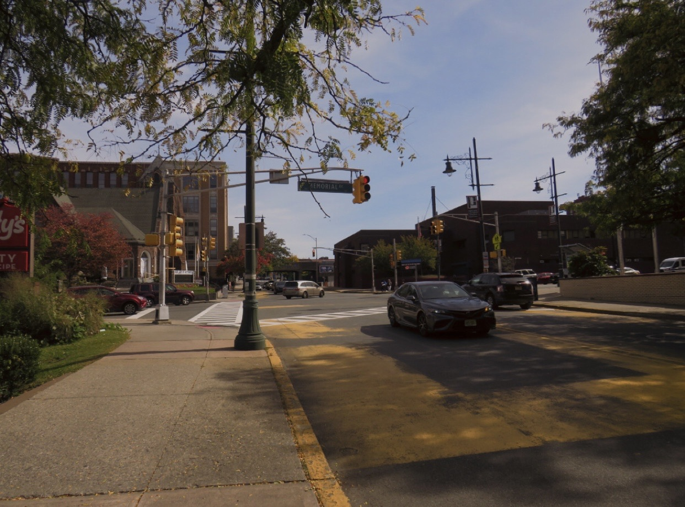

(The city is not just a backdrop, it is the living, breathing environment where higher education happens, and multiple communities are woven together.)

# The Urban Campus Blueprint

## Downtown Integration

The intersection of Broadway and Memorial in downtown Paterson, where Passaic County Community College (PCCC) is located, does not feel like a traditional college campus. There are no rusting iron gates, no manicured lawns, and no quiet ivy-covered lecture halls isolated from the real world.

Instead, the campus heartbeat matches the rhythm of the city. Step outside PCCC Academic Hall, and the air is smothered with sounds of NJ Transit and jitney buses lined up at the curb. Laughter of students, the slamming of campus doors, the beeping of IDs being scanned, men greeting each other from across the street, and the honking of horns from cars trying to get on with their day.

On any given morning, there is a sea of commuters carrying heavy backpacks, weighted down by full-time work schedules, streaming past historic brick structures and slipping through the doors of modern classrooms.

(A bus parked along the curb in downtown Paterson.)

# Engine of Social Mobility

## The Bigger Picture

This seamless integration into the downtown grid is how PCCC successfully functions as an engine for local social mobility. Operating without traditional dormitories, the college relies on an infrastructure designed to support a commuter population.

With customized programs such as the new Automotive Technology Center and expanded training facilities, alongside affordable financial pathways like the state’s tuition-free grant programs, PCCC serves as a pillar for the community.

In an area like Downtown Paterson, where economic and structural barriers often hinder academic ambitions, the college proves that an institution does not need to isolate its students from the challenges of urban life to prepare them to rise above them.

## Transmission of Opportunity

For many Paterson residents, the biggest obstacle to higher education is financial and structural. This is where PCCC shifts from a physical landmark to a systematic dismantling of the barriers that have traditionally kept urban students out of the classroom.

In a city where reality often forces tough decisions between rent and tuition, PCCC serves as a financial lifeline. The bedrock of this is the state’s Community College Opportunity Grant (CCOG), a financial aid program that covers the remaining tuition and approved educational fees for eligible students.

Rather than trapping students in a vicious cycle of generational debt, the college builds a bridge to a degree that requires zero out-of-pocket financial burden on the community’s most vulnerable populations.

## A Schedule Built for Real Life

Beyond the price tag, time is the ultimate luxury for a student balancing adulthood. Recognizing that many students are full-time employees, care providers, and parents, PCCC designs its curriculum to be highly flexible.

The Center for Continuing Education and Workforce Development structures classes across a broad spectrum. There are day, evening, and weekend blocks at the main Paterson campus for irregular shift work.

Hybrid and fully online programs are offered, allowing parents to attend lectures from their living rooms while still maintaining a balance in caring for their children. PCCC also offers short-term, targeted tuition in high-demand trades, such as HVAC/R technology, and in specialized healthcare sectors. Instead of committing to a two-or four-year traditional degree, a “short-term certificate” allows one to quickly master specific skills to qualify for immediate employment.

# Meeting the City Where It Stands

Passaic County Community College creates a culture that mirrors Paterson’s resilient spirit. A classroom can house a recent 19-year-old high school graduate alongside a 40-year-old mother/father. By meeting Paterson residents where they stand, economically, geographically, and logistically, the college functions less like a rigid academic Ivy League and more like a fluid community resource.

The success of PCCC in downtown Paterson proves that higher education thrives when it refuses to hide behind gates. It offers financial accessibility, an easy commute for those without a car, and scheduling flexibility. The college does more than teach; it reshapes the economic future of the city and its residents, one student at a time.

(Downtown Paterson.)
