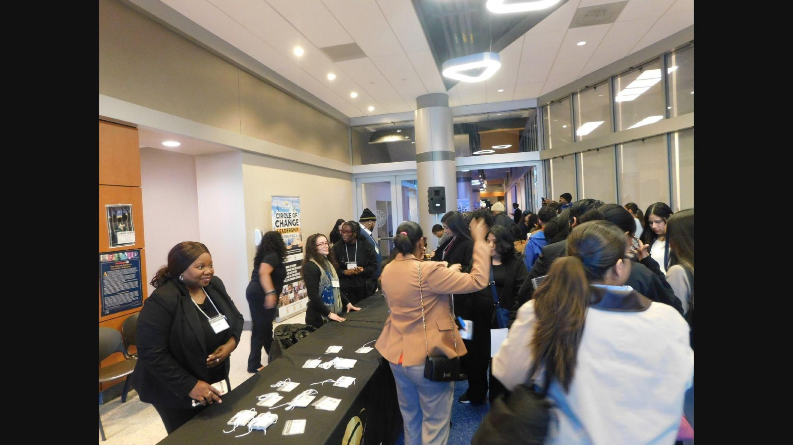
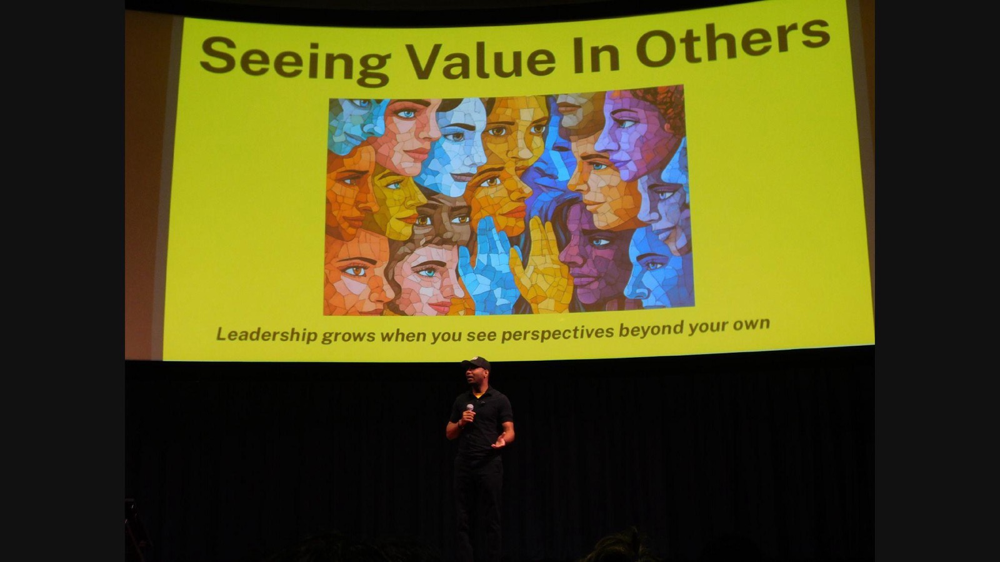
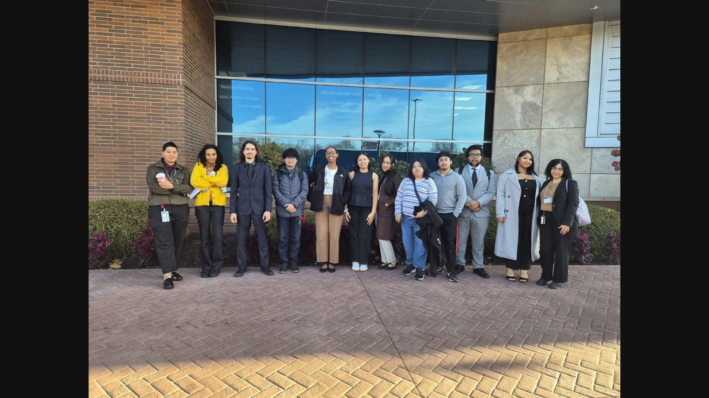

Most of us think of leadership as a title: president, captain, chair. After spending Friday and Saturday at the 2026 Circle of Change Leadership Experience, I left with a different definition. Leadership is what you provide to other people. If nobody is following you, the question isn't "why won't they listen?" It's "what am I giving them that's worth following?"

That idea came up again and again, including in a session with Dr. Alex Ellis. The message was simple: use your influence to add value. Always look for a way to serve. And build relationships before you need them, not the week you need a favor.

## Your brand walks in before you do

One of the first lessons was uncomfortable but true. Your appearance is your first impression, so invest in your image. That isn't about expensive clothes. It's about showing up like you take yourself, and the people in the room, seriously.

That led into personal branding. Your brand is what people think of when you leave the room. A good one can open doors to places you can't get into on your own. Here is the part that stuck with me most: branding is consistency. You don't build a reputation with one big moment. You build it by being the same person on Monday that you were on Friday.

## How you say it matters

We also worked on communication. It comes down to three things: body language, clarity and directness, and passion when you speak. A strong message has a shape. You start with the context, explain why it matters, and then bring the solution.

One line I wrote down was, "I'm not here to be liked. I'm here to do what's right." Leaders who chase approval end up saying nothing. Leaders who are clear about what's right, and who are passionate about what they want, give people something to stand behind. That doesn't mean being cold. The best leaders bring a calming presence, respect other people's boundaries, and make people look forward to seeing them.

## Resilience and competence

Saturday's focus was resilience and competence. My favorite idea from the whole weekend was that admiration should inspire you, not replace you. It's fine to look up to someone, but the goal is to become more yourself, not a copy of them.

We talked about three skills behind good leadership: self-awareness, social awareness, and responsible decision-making. Then we took a look at our own leadership styles. Mine came out as driven and systematic. I chase goals hard, and I like to build a process to get there. Knowing that helps me see where I need to grow, like patience, and the kind of encouragement other people need from me.

Two last lines from my notebook: "Your habits become your legacy," and "Doing nothing is a bad choice." We were also asked to write down who we are, and I'd recommend every student try it.

## What I'm taking home

The weekend left me with a few questions I'm still answering. What are my natural talents, the things that came easily? And what are my strengths, the things I've built over time through work? Knowing the difference matters, because the second list is the one you control.

I also came home with a clearer idea of what leadership asks of me. Have a vision and chase it with the utmost conviction. And love people, which to me means doing good regardless of how I feel and despite how people treat me.

Here at PCCC, opportunities like the Circle of Change are out there, but a lot of students don't know how to reach them. If you get the chance to go next year, take it. And if you can't, start with the simplest lesson from the weekend. Find a way to add value to someone today, and keep doing it until it becomes who you are.

A special thank you to PCCC's SSS-STEM program, especially my advisor, Janet Castillo, and Director Jihan Ahmed, for supporting me and making it possible for me to attend the Circle of Change.
