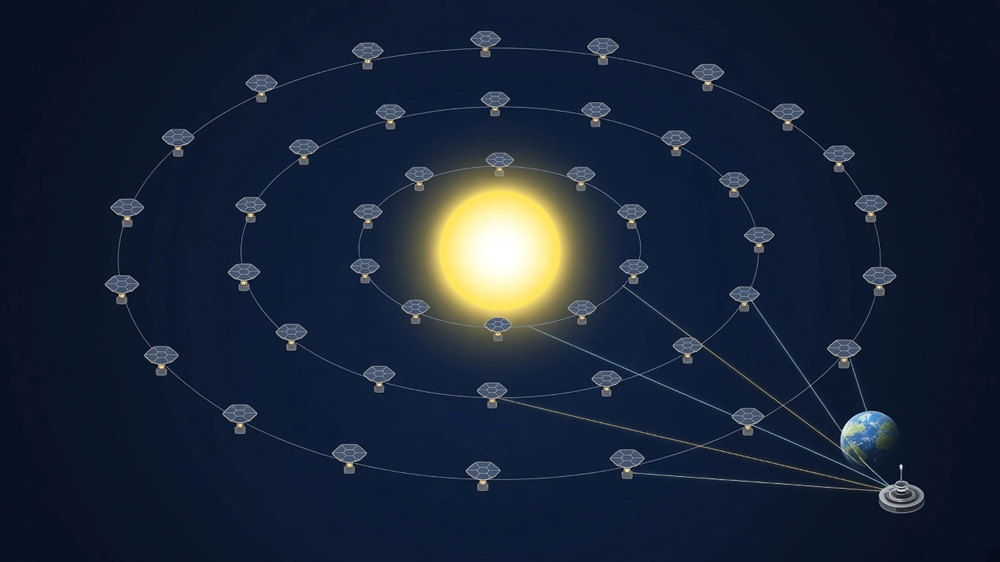

*Illustration: AI-assisted image of a swarm of solar collectors orbiting the Sun, with Earth in the foreground.*

Every problem AI solves makes the next one come faster. That's the part of this story nobody is ready for.

Look at the dates. In April 2018, the FDA authorized IDx-DR, software that checks photos of the eye for diabetic eye disease with no doctor reading the image first. According to the FDA, it was tested on 900 patients at 10 sites before it was cleared. It was the first fully autonomous AI diagnostic. For the first time, a machine was trusted to make a medical call on its own.

Two years later, in February 2020, researchers at MIT reported in the journal Cell that a deep learning program had found halicin, a molecule unlike normal antibiotics that killed a wide range of germs, including drug-resistant ones, and cleared infections in mice. It was the first antibiotic discovered by deep learning.

Five years after that, in June 2025, Nature Medicine published a trial of rentosertib, a drug for a scarring lung disease. Both the drug and the target it hits were found using generative AI. In a 12-week trial with 71 patients, the drug looked safe, and lung function went up in the highest-dose group while it went down on placebo.

Then look at this fall. On Oct. 8, Google DeepMind's AlphaProof Nexus was published in Science after it solved nine open Erdős problems, two of them unsolved for 56 years, with every step checked by a proof-checking program called Lean. On Nov. 2, a model called GAP was published in npj Climate and Atmospheric Science after running weather forecasts and climate simulations from one system. In July, Nature Machine Intelligence published an AI method that designs brand-new crystal structures for materials. And today, Nov. 13, researchers reported in Acta Pharmacologica Sinica that AlphaFold helped them screen about three million compounds and find one, QL07, that slowed a type of lung cancer in mice.

Read that list again. The gaps used to be years. Now they're weeks. Math, weather, materials and medicine are all moving at the same time.

To be fair, none of these AI drugs is an approved medicine yet. Halicin and QL07 have only been tested in mice, rentosertib was a small early trial, and the crystals exist only as computer designs so far. I'm only counting results that have been published in journals or cleared by the FDA. But the pattern doesn't depend on any one result. It depends on the speed.

Here's why I think it keeps speeding up. Every tool AI builds becomes a tool for the next problem. AlphaFold predicts the shapes of proteins, and now it's being used to hunt for cancer drugs. A system that checks math proofs doesn't forget how it solved the last one. Each solved problem shortens the road to the next.

Now my bigger belief. Right now, AI runs on power plants here on Earth, which brings back every problem I wrote about in my last article: wars, blackouts, pipelines. I believe the next step is to automate AI's infrastructure and power it with solar energy collected in space, where there's no night and no clouds. In 2023, Caltech wirelessly transmitted power in orbit and beamed a detectable signal down to its campus in Pasadena. Scale that up, and AI never has to stop. It solves problems 24 hours a day, 7 days a week, while we sleep.

*Illustration: AI-assisted diagram of solar satellites beaming power to Earth.*

If the time between breakthroughs keeps shrinking, I believe we eventually reach a point where AI has solved every problem humanity can think of. Disease, hunger, energy, all of it.

So what does being alive look like then?

For most of history, being alive has meant working to survive. We trade most of our waking hours for food, rent and the right to keep going. Take that away and you're left with the question most of us have never had time to ask: what would you do with your life if you didn't have to earn it?

I picture a future where humans live in peace and connect with the universe on a deeper level. We look up at the stars because we finally have time to wonder about them, not because they're a problem to solve. Labor for survival is no longer a distraction.

So ask yourself: what will you think about?

That future isn't guaranteed. The same technology could be locked up by a few people, used for war, or used to make most of us useless instead of free. Who owns the machines and who benefits from them will decide everything. The countdown is real, but where it ends isn't written yet.

This is a future we will have to fight for.

## Sources

- FDA De Novo order for IDx-DR, DEN180001, Apr 11, 2018: https://www.accessdata.fda.gov/cdrh_docs/pdf18/DEN180001.pdf
- FDA review summary for IDx-DR (900 patients, 10 sites): https://www.accessdata.fda.gov/cdrh_docs/reviews/DEN180001.pdf
- Stokes, Collins et al., Cell, Feb 20, 2020 (halicin), PMC copy: https://pmc.ncbi.nlm.nih.gov/articles/PMC8349178/
- Xu, Ren et al., Nature Medicine, Jun 3, 2025 (rentosertib): https://www.nature.com/articles/s41591-025-03743-2
- Tsoukalas et al., Science, Oct 8, 2026 (AlphaProof Nexus): https://www.science.org/doi/10.1126/science.aej2213
- Yang et al., npj Climate and Atmospheric Science, Nov 2, 2026 (GAP): https://www.nature.com/articles/s41612-026-01585-4
- Park and Walsh, Nature Machine Intelligence, Jul 6, 2026 (crystals): https://www.nature.com/articles/s42256-026-01262-4
- Qu, Zhang, Wang et al., Acta Pharmacologica Sinica, Nov 13, 2026 (QL07): https://www.nature.com/articles/s41401-026-01957-9
- Caltech, Jun 1, 2023 (space solar demonstrator): https://www.caltech.edu/about/news/in-a-first-caltechs-space-solar-power-demonstrator-wirelessly-transmits-power-in-space
