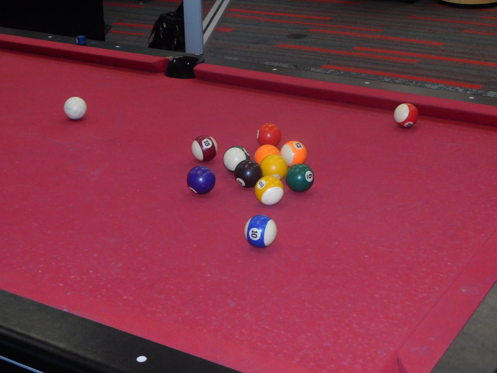
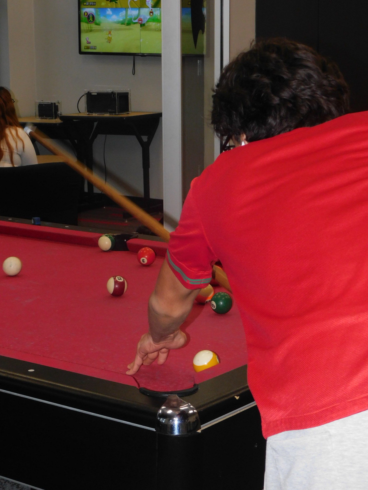
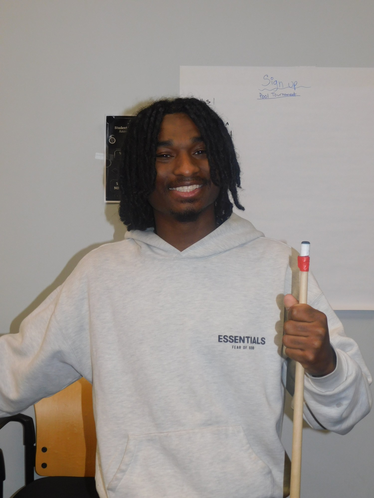

After a six-game win streak on the pool table, Steven Garcia entered the Den and blew the competition away, earning him this semester’s Pool Tournament Champion title.

The Center for Student Engagement and Panther’s Den Coordinator Raymond Scott hosted the annual Pool Tournament in the Panther’s Den. The room was full of laughs and intense competition as students competed against each other for a chance to be crowned Champion of the Fall semester.

Twelve students competed in this tournament, rotating each match to face the winner of the previous round. In order to win the tournament, students had to win six consecutive games. If a player lost a round, their standing reset to zero.

“I haven’t played pool in months, but since I had a break in between my classes, I thought I could join for fun,” Joshua Chavez ’28 shared when asked why he decided to play. Outside of the game, Joshua and the other participants took the opportunity to get to know each other and enjoy the atmosphere of the space.

The Center for Student Engagement plans to host the tournament again on March 18th. Save the date; who knows, maybe you will be the next crowned champion.
